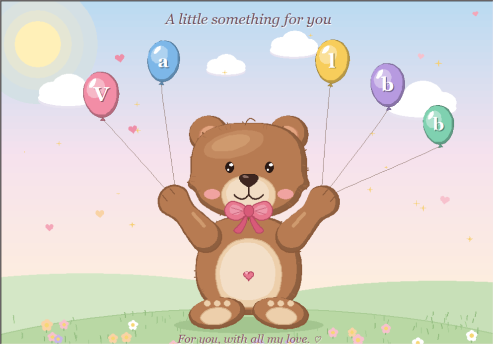

# 🧸 A Little Bear for Valbb ♡

A little teddy bear carrying something special: **five balloons, one for each letter of your name.**

This project is a small animated creation made with **Python**, featuring an adorable brown teddy bear holding colorful floating balloons that spell *Valbb*.

Surrounded by soft pastel colors, drifting clouds, sparkling stars, and floating hearts, this little bear was created to bring a smile to someone's face.

Because some gifts don't need a special occasion. Sometimes, you just want to make someone feel loved.

## ✨ Features

- 🧸 **Adorable Teddy Bear:** A fluffy brown bear with a little pink bow and a heart on its belly.
- 🎈 **Personalized Balloons:** Five colorful balloons spelling out "Valbb".
- 💗 **Floating Hearts:** Little hearts gently moving across the scene.
- ☁️ **Animated Clouds:** Soft clouds drifting through the pastel sky.
- ⭐ **Sparkling Stars:** Small decorative stars with animated twinkling effects.
- 🌸 **Pastel Landscape:** A warm, colorful background with hills, grass, and flowers.
- 💌 **Romantic Messages:** Sweet little phrases displayed throughout the scene.

## 🎨 Graphical Representation

### The final result

<p align="center">
  
</p>

## 🛠️ Technologies Used

- Python 3
- Turtle Graphics
- Tkinter Canvas
- Math
- Random

## 🎮 Controls

| Key | Action |
|:---:|:---|
| `SPACE` | Pause / Resume animation |
| `ESC` | Close the animation |

## 🚀 How to Run

1. Make sure Python 3 is installed on your computer.
2. Clone this repository:

   ```bash
   git clone https://github.com/laetg404/a-little-bear-for-valbb.git
   ```

3. Navigate to the project directory:

   ```bash
   cd a-little-bear-for-valbb
   ```

4. Run the Python script:

   ```bash
   python main.py
   ```

The animation window will open automatically.

## 📁 Project Structure

```text
a-little-bear-for-valbb/
│
├── graphical-representation/
│   └── bear.png
│
├── main.py
└── README.md
```

## ♡ A Little Bear, Just for You

My sweetest Valbb,

If I could send you a little piece of happiness, I think it would arrive looking something like this.

A tiny bear, holding colorful balloons with your name on them, carrying a little heart close to its own.

I wanted to make something that would remind you how special you are to me. Something small, sweet, and entirely yours.

I hope this little bear makes you smile, even on the days when you need it most. And if you ever wonder how much I love you, just remember that even my little creations find their way back to you.

**Every little thing I make has a piece of my heart in it, and this one is no exception.**

All my love, always. ♡

---

<sub>Part of a collection of little projects created with love.</sub>

❤️
